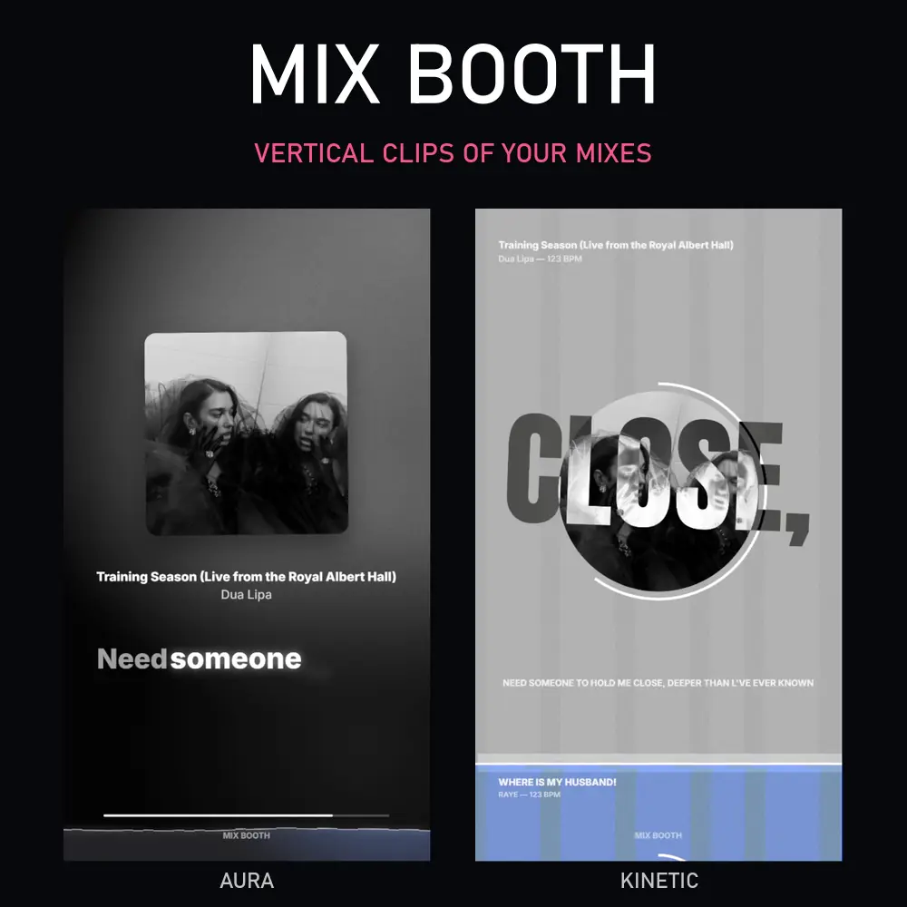
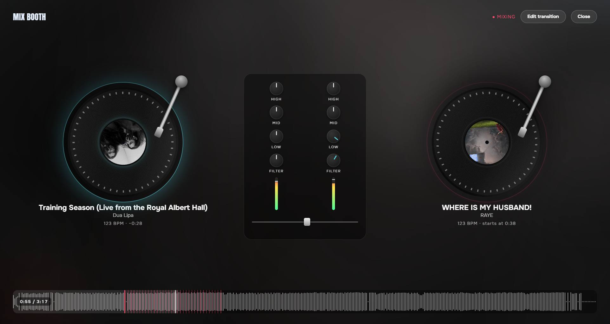
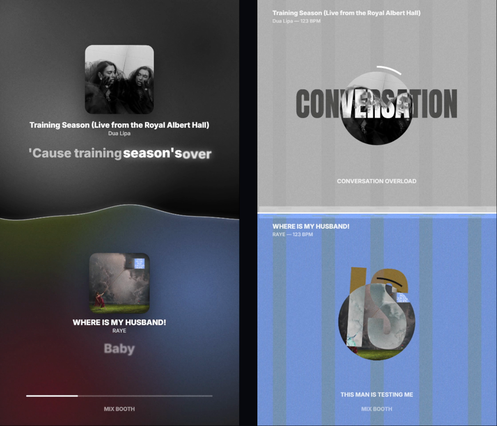
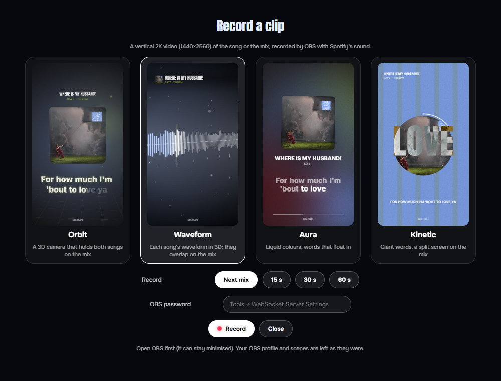
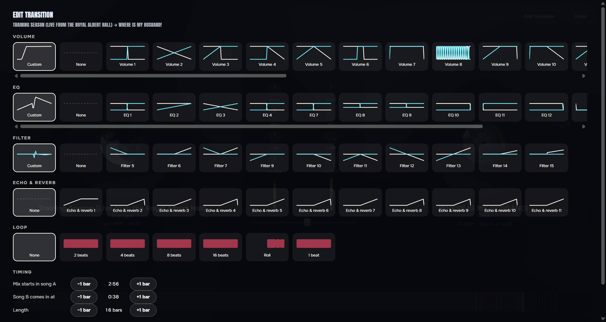

# Mix Booth

A Spicetify extension that turns Spotify's mixed playlists into a DJ booth. Watch each transition happen on two spinning decks, edit how every transition sounds, and record vertical clips of your mixes.



## The booth

Open it with the **Mix Booth** button (two records) in the player bar.



- **Two decks:** the song that's playing and the one that comes next, spinning at their real BPM. A light ring pulses on every beat, and each tonearm drops onto its record when that song starts playing
- **Scratch:** drag the record that's playing to move through the song. One turn is one bar
- **A mixer that plays itself:** the EQ (high, mid, low) and filter knobs of each channel move along the transition's real curves, the level meters bounce with how loud each moment is, and the crossfader slides as the mix happens
- **Echo, reverb and loops** light up while they play
- **Waveform timeline** of the song that's playing, with the mix zone marked. Click or drag it to jump anywhere, or use the arrow keys
- **Countdown** for the last ten seconds before a mix, and a background that blends from one song's colors into the other's

## Vertical clips

Click **● Clip** in the booth to record a 1080×1920 video of the song or the mix, ready for TikTok, Reels or Shorts. [OBS Studio](https://obsproject.com) does the recording, with Spotify's own sound.



- **Three styles**, each with a live preview, and you pick one every time you record:
  - **Orbit:** each song is a small 3D space (its cover, its colours, its title and its lyrics) and a camera floats through it, pulsing on the beat. When the mix starts the camera pulls back until both songs are in the shot, holds them while they play together, then flies down to the new one
  - **Aura:** a liquid gradient made from the cover's colours, the cover floating above it, and the lyrics coming in word by word out of a blur. On the mix, the screen splits along a liquid wave: the outgoing song stays on top and the incoming one rises from the bottom, each with its own cover, colours and lyrics at the same time
  - **Kinetic:** the word being sung fills the screen, each one arriving with its own motion. On the mix, the screen splits in two and both songs sing at once, each half with its own giant word, and the line between them glitches on every beat
- **Real data:** the lyrics come with each word's timing (from [Spicy Lyrics](https://github.com/Spikerko/spicy-lyrics)' saved copy, or Spotify's), and the animation follows the song's real beat and the mix's real progress
- **What to record:** the next mix (from six seconds before it to just after it ends), or 15, 30 or 60 seconds
- **One click:** a 3-2-1 countdown, then OBS records and stops by itself. The clip is saved as an MP4 in OBS's recordings folder, and Spotify tells you where
- **Sharp at full size:** OBS draws the clip itself at a true 1080×1920 and 60 fps (in a browser source, with the same design you see in Spotify), so it doesn't depend on how big your screen is. It records at OBS's high quality setting, about 2 MB per second, so the video still looks good after TikTok or Instagram compress it



### Setting up OBS once

1. Install [OBS Studio](https://obsproject.com) (version 28 or newer) and open it. It can stay minimised.
2. In OBS, open **Tools → WebSocket Server Settings**, tick **Enable WebSocket server** and copy the password (**Show Connect Info**).
3. Paste that password in the clip panel. It's saved only on your computer.

Mix Booth creates its own OBS profile and scene called **Mix Clip**, so your usual profile, scenes and canvas are never changed. While recording it shows only the clip, records only Spotify's sound, and mutes your desktop audio and microphone; afterwards it switches everything back. If your OBS has no browser source, it captures Spotify's window instead (softer, since it's stretched to 1080×1920).

## The transition editor

Click **Edit transition** in the booth, or right-click a song in a playlist and choose **Edit transition to next song**.



- Every volume, EQ, filter, echo/reverb and loop style Spotify has, each drawn as its curve (outgoing in white, incoming in blue)
- Move where the mix starts in each song, and its length, one bar at a time
- **Preview** plays the mix from a few seconds before it starts, then goes back to what you were playing
- **Save to playlist** stores it in the playlist, the same way Spotify's own mix editor does. Only the playlist's owner can save

## Requirements

- [Spicetify](https://spicetify.app)
- A Spotify version with mixed playlists (the **Mix** button on your playlists)
- For clips: [OBS Studio](https://obsproject.com) 28 or newer, on Windows (it uses OBS's per-app audio capture)

It works with any theme. It also pairs with [Mix Lyrics](https://github.com/SrPictus/mix-lyrics), which shows both songs' lyrics during a mix, and with the [Vitral](https://github.com/SrPictus/vitral) theme. Neither is required.

## Install

### Marketplace (recommended)

Open the **Marketplace** in Spotify, go to the **Extensions** tab, search for **Mix Booth** and click **Install**. It updates on its own.

### Manual, on Windows

In PowerShell:

```powershell
Invoke-WebRequest -UseBasicParsing "https://raw.githubusercontent.com/SrPictus/mix-booth/main/mix-booth.js" -OutFile "$env:APPDATA\spicetify\Extensions\mix-booth.js"
```

```powershell
spicetify config extensions mix-booth.js
```

```powershell
spicetify apply
```

### Manual, on macOS and Linux

```bash
curl -fsSL https://raw.githubusercontent.com/SrPictus/mix-booth/main/mix-booth.js -o ~/.config/spicetify/Extensions/mix-booth.js
```

```bash
spicetify config extensions mix-booth.js
```

```bash
spicetify apply
```

### Uninstall

From the Marketplace, click **Uninstall** on Mix Booth. If you installed it by hand:

```bash
spicetify config extensions mix-booth.js-
```

```bash
spicetify apply
```

## Known limits

- It uses Spotify's internal mixing functions, so a Spotify update can break it.
- The booth shows the transition Spotify will play; it doesn't change the sound by itself. Only **Save to playlist** changes anything.
- Style names are numbers, because Spotify doesn't give them names. The drawing on each card shows what it does.
- Clips sound as loud as Spotify is playing: if Spotify is muted, the recording waits until you turn it up.
- Clips include the song's audio. Platforms like TikTok or Instagram may mute a video with copyrighted music; if that happens, add the song from the app's own music library instead.
- Tested on Windows with Spotify 1.3.9 and OBS 32.

## License

[MIT](LICENSE)
