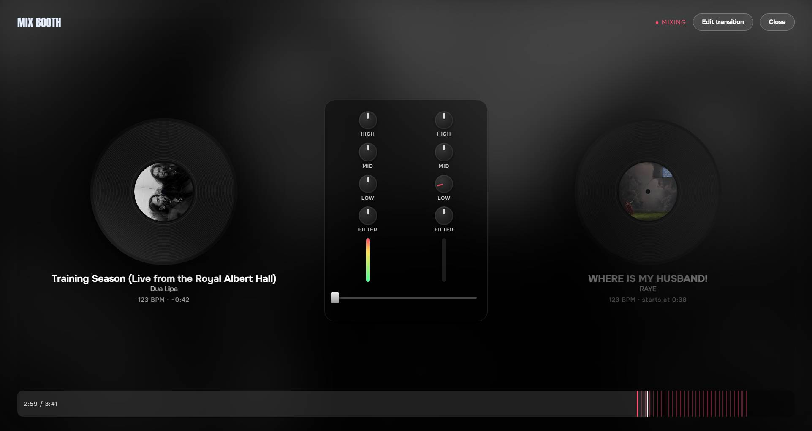
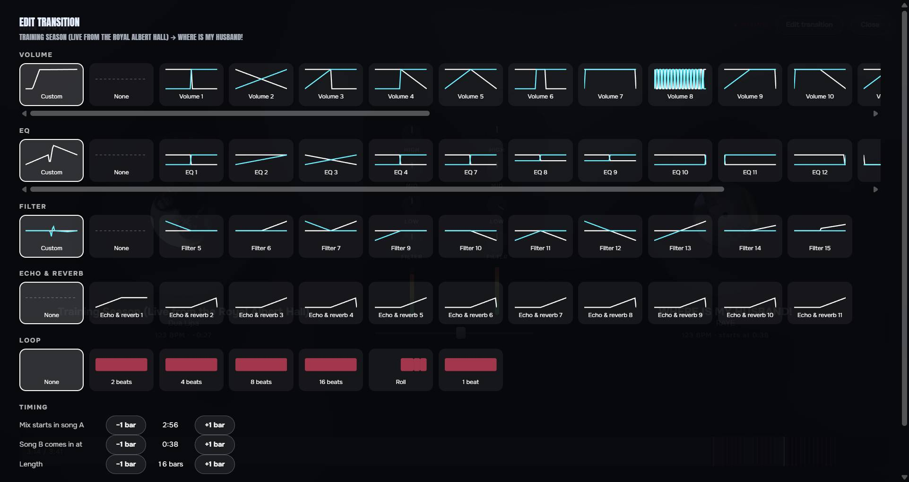

# Mix Booth

A Spicetify extension that turns Spotify's mixed playlists into a DJ booth. Watch each transition happen on two spinning decks, and edit how every transition sounds.



## The booth

Open it with the **Mix Booth** button (two records) in the player bar.

- **Two decks:** the song that's playing and the one that comes next, spinning at their real BPM
- **A mixer that plays itself:** the EQ (high, mid, low) and filter knobs of each channel move along the transition's real curves, the level meters follow each song's volume, and the crossfader slides as the mix happens
- **Echo, reverb and loops** light up while they play
- **Timeline** of the current song with the mix zone marked, and a countdown to the next mix

## The transition editor

Click **Edit transition** in the booth, or right-click a song in a playlist and choose **Edit transition to next song**.



- Every volume, EQ, filter, echo/reverb and loop style Spotify has, each drawn as its curve (outgoing in white, incoming in blue)
- Move where the mix starts in each song, and its length, one bar at a time
- **Preview** plays the mix from a few seconds before it starts, then goes back to what you were playing
- **Save to playlist** stores it in the playlist, the same way Spotify's own mix editor does. Only the playlist's owner can save

## Requirements

- [Spicetify](https://spicetify.app)
- A Spotify version with mixed playlists (the **Mix** button on your playlists)

It works with any theme. It also pairs with [Mix Lyrics](https://github.com/SrPictus/mix-lyrics), which shows both songs' lyrics during a mix, and with the [Vitral](https://github.com/SrPictus/vitral) theme. Neither is required.

## Install

### Marketplace (recommended)

Open the **Marketplace** in Spotify, go to the **Extensions** tab, search for **Mix Booth** and click **Install**. It updates on its own.

### Manual, on Windows

In PowerShell:

```powershell
Invoke-WebRequest -UseBasicParsing "https://raw.githubusercontent.com/SrPictus/mix-booth/main/mix-booth.js" -OutFile "$env:APPDATA\spicetify\Extensions\mix-booth.js"
```

```powershell
spicetify config extensions mix-booth.js
```

```powershell
spicetify apply
```

### Manual, on macOS and Linux

```bash
curl -fsSL https://raw.githubusercontent.com/SrPictus/mix-booth/main/mix-booth.js -o ~/.config/spicetify/Extensions/mix-booth.js
```

```bash
spicetify config extensions mix-booth.js
```

```bash
spicetify apply
```

### Uninstall

From the Marketplace, click **Uninstall** on Mix Booth. If you installed it by hand:

```bash
spicetify config extensions mix-booth.js-
```

```bash
spicetify apply
```

## Known limits

- It uses Spotify's internal mixing functions, so a Spotify update can break it.
- The booth shows the transition Spotify will play; it doesn't change the sound by itself. Only **Save to playlist** changes anything.
- Style names are numbers, because Spotify doesn't give them names. The drawing on each card shows what it does.
- Tested on Windows with Spotify 1.3.8.

## License

[MIT](LICENSE)
